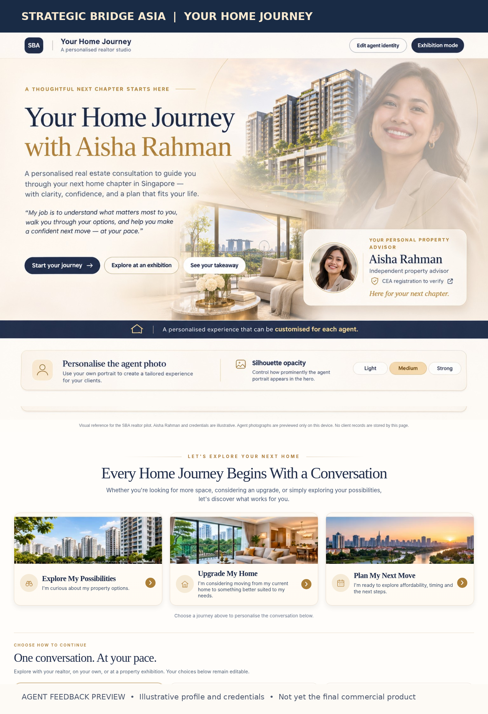

# Strategic Bridge Asia | Your Home Journey

### Personalised realtor consultation studio | Agent feedback preview

This is a **working concept demonstration** for independent real estate agents in Singapore, not a final product launch. The first page and the three client journey choices have been designed for agent feedback. **Aisha Rahman, her photograph and any CEA reference are illustrative examples only**, not verified agent credentials.

## Preview: first page and the three client journeys

## Try the interactive demonstration

**[Download the working HTML demo](https://github.com/rethinkingislamnet-max/SBA/raw/refs/heads/main/previews/your-home-journey-agent-feedback-12nov2026.html)**

Open the downloaded HTML file in a web browser. It runs locally, and your entries remain in your browser unless you explicitly share them. This is **not yet a one-tap hosted web application**.

The demonstration includes:

1. A personalised first page with editable agent identity, professional profile and adjustable photo transparency.
2. A second page inviting the client to **Explore My Possibilities**, **Upgrade My Home**, or **Plan My Next Move**.
3. An initial guided conversation and client takeaway to demonstrate the consultation experience.

## We'd appreciate your professional opinion

- Would you use a personalised version of this tool when meeting clients?
- Do the design and first impressions look credible and professional?
- Which of the three journeys would be most relevant to your clients?
- What practical feature is missing or needs improvement?

Please send your thoughts directly to the person who shared this preview. Do **not** enter actual client names, identification numbers, contact details, finance records or confidential information while testing.

*Strategic Bridge Asia | Concept review, November 2026. The agent identity is a demonstration placeholder, and this prototype is not integrated with a live CRM, client storage system or verified property listings.*
